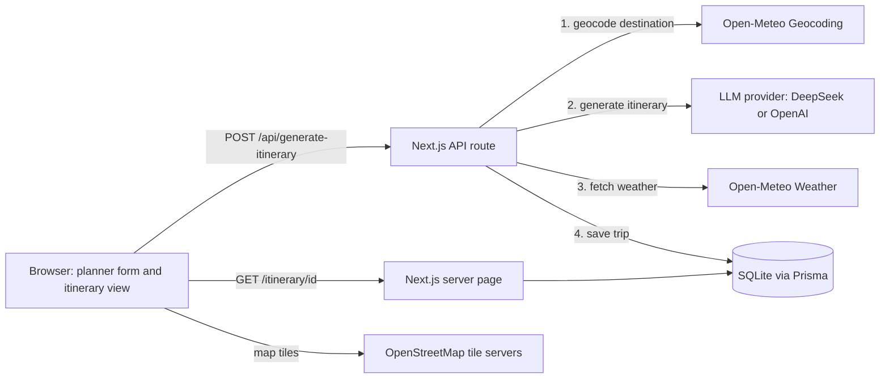

# Wayfarer AI

An AI travel planner. Enter a destination, trip length, budget and interests, and Wayfarer AI generates a day-by-day itinerary with a map-synced timeline, live weather, and calendar export.

Built for FESE307.

## Features

- **Schema-enforced AI itineraries:** the LLM must return JSON that matches a Zod schema (Vercel AI SDK `generateObject`).
- **Hallucination guard:** the destination is geocoded first, and any stop more than 60 km from the city centre is dropped.
- **Map and timeline:** a split view with numbered pins on a Leaflet / OpenStreetMap map.
- **Live weather:** current conditions, a 16-day forecast and simple alerts (rain, heat, freezing) from Open-Meteo.
- **Calendar export:** download a `.ics` file or add individual stops to Google Calendar.
- **Saved trips:** every trip is stored and can be reopened or deleted by the browser that created it.

## Tech stack

| Area | Technology |
| --- | --- |
| Framework | Next.js 14 (App Router), React 18, TypeScript |
| Styling | Tailwind CSS, Radix UI, lucide-react |
| AI | Vercel AI SDK, any OpenAI-compatible API (DeepSeek by default, OpenAI supported) |
| Validation | Zod |
| Database | SQLite through Prisma |
| Maps | Leaflet with OpenStreetMap tiles (no key needed) |
| Weather and geocoding | Open-Meteo (no key needed) |
| Calendar | `ics` package |

## Architecture



**Request flow**

1. The planner form sends the destination, number of days, budget, vibe tags and start date to `POST /api/generate-itinerary`.
2. The server validates the input with Zod and checks the database is reachable.
3. The destination is geocoded with Open-Meteo and the coordinates are passed to the LLM as the trip centre.
4. The LLM returns an itinerary that must match the schema. Stops far from the centre are discarded.
5. Weather is fetched (best effort), and the trip is saved with Prisma.
6. The API returns the trip id, and the browser opens `/itinerary/[id]`.

## Getting started

### Prerequisites

- Node.js 18.17 or newer
- An API key for DeepSeek or OpenAI

### Setup

1. Install dependencies:

   ```bash
   npm install
   ```

2. Copy the example environment file and add your API key:

   ```bash
   cp .env.example .env
   ```

3. Create the database tables:

   ```bash
   npm run db:push
   ```

4. Start the development server and open http://localhost:3000:

   ```bash
   npm run dev
   ```

## Environment variables

Copy `.env.example` to `.env`. Never commit `.env` or share real API keys.

| Variable | Required | Description |
| --- | --- | --- |
| `DATABASE_URL` | Yes | SQLite file path. Default: `file:./dev.db` |
| `DEEPSEEK_API_KEY` | Yes (or `OPENAI_API_KEY`) | API key for DeepSeek, the default provider |
| `DEEPSEEK_BASE_URL` | No | Default: `https://api.deepseek.com/v1` |
| `DEEPSEEK_MODEL` | No | Default: `deepseek-chat` |
| `OPENAI_API_KEY` | Alternative | Use OpenAI instead; leave the DeepSeek key empty |
| `OPENAI_BASE_URL` | Alternative | Set to `https://api.openai.com/v1` when using OpenAI |
| `OPENAI_MODEL` | Alternative | For example `gpt-4o-mini` |

Weather, geocoding and maps need no keys.

## Scripts

| Command | What it does |
| --- | --- |
| `npm run dev` | Start the development server |
| `npm run build` | Generate the Prisma client and build for production |
| `npm run start` | Run the production build |
| `npm run lint` | Run ESLint |
| `npm run typecheck` | Run the TypeScript compiler without emitting files |
| `npm run db:push` | Create or update the database tables |
| `npm run db:studio` | Open Prisma Studio to browse the data |

## Project structure

```
prisma/schema.prisma          Database models (Trip, ItineraryItem)
src/app/                      Pages and API routes (App Router)
  api/generate-itinerary/     Generate and save an itinerary
  api/trips/[id]/             Get or delete a trip, plus .ics export
  api/weather/                Weather proxy
  itinerary/[id]/             Itinerary page
  trips/                      Saved trips list
src/components/               UI components (planner form, map, timeline, weather)
src/lib/                      Core logic
  generate.ts                 LLM call and output sanitising
  schema.ts                   Zod schemas and shared types
  weather.ts                  Geocoding and weather
  calendar.ts                 .ics and Google Calendar links
  user.ts                     Anonymous cookie identity
```

## Security and privacy

- There are no accounts. Each browser gets an anonymous `wf_uid` cookie, stored with every trip.
- Only the browser that created a trip can delete it. Anyone with a trip link can view it.
- API keys are read on the server only and are never sent to the browser.
- See [docs/SECURITY.md](docs/SECURITY.md) for the full data flow, PII handling, and the main AI risk with its mitigation.

## Known limitations

- No real authentication yet. Swap `src/lib/user.ts` for a proper auth provider to get accounts.
- Generated places are not verified against a places database, so check opening hours before travelling.
- OpenStreetMap's public tile servers are intended for development and low traffic.
